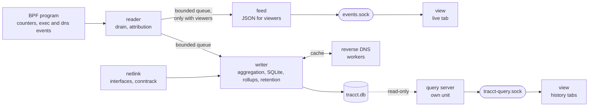

# Design

This document describes how tracct collects, attributes and stores traffic, what it can
and cannot see, and the principles the code must keep.

## Goal

Record traffic per process detailed enough to explain a spike after the fact: which program
(path, command line, parent, user, systemd unit, network namespace, interface) exchanged how
many bytes with which remote address, domain and port, in which time window; next to it the
totals of every interface, and the flows the host only forwards. Security is out of scope:
there is no tamper evidence, no alerting, and a program is identified by its path.

The tool exists because no existing one records all of this together, on a headless server,
and keeps it. Interface counters such as vnstat show that a spike happened, not who caused
it. Live monitors such as nethogs and bandwhich show only the present. Per-process counters
with history (atop with netatop, Netdata, systemd's `IPAccounting=`) do not keep the peer;
flow accounting (ntopng, pmacct, conntrack with ulogd2) does not know the process.
Application firewalls such as OpenSnitch and Little Snitch are built for filtering on
desktops.

## Data sources

Per-process traffic comes from one BPF CO-RE program, `src/tracct/bpf/tracct.bpf.c`,
loaded through the ctypes libbpf wrapper in `bpf_wrapper.py`; interfaces and forwarded
traffic come from netlink.

- **Socket byte counters.** fexit programs on `inet_sendmsg`, `inet_recvmsg`,
  `inet6_sendmsg`, `inet6_recvmsg` and `sock_common_recvmsg`, plus `tcp_splice_read` /
  `mptcp_splice_read` (splice and sendfile receives), `tcp_read_sock` restricted to io_uring
  zero-copy receives, and raw `packet_sendmsg` / `packet_recvmsg`, `tun_get_user` /
  `tun_do_read` and AF_XDP copy-mode sends. Opt-in (`mmap_ring_rx`): AF_PACKET and AF_XDP
  mmap-ring receives. Hooks whose kernel symbol is missing are skipped with a log line.
  Socket I/O of kernel threads (nfsd, the workers of the NFS and SMB clients, ksmbd) counts
  under the thread's comm, without an executable.
- **In-kernel aggregation.** Bytes and packets are summed per connection, keyed by
  (pid, netns, saddr, daddr, lport, dport, protocol), in LRU hash maps (`conn_stats4`,
  `conn_stats6`, `conn_stats_packet`). Each value also carries the process's and parent's
  comm, device and inode, and the uid. Userspace drains the maps once per second with
  lookup-and-delete, so its cost scales with active connections, not packets. An IPv4 peer
  of a dual-stack IPv6 socket (`::ffff:a.b.c.d`) is recorded as IPv4, so a server listening
  on `[::]` has its IPv4 clients under their own addresses and its local address on its
  interface.
- **Exec events.** A kretprobe on `execve` sends each new process to a ring buffer. They are
  resolved while the process is young, which fills the caches its connections fall back on
  after it exits, and with `every_exe` they are logged as rows without traffic.
- **Domains.** A uprobe on libc `getaddrinfo` reports each answer, mapping the address to
  the name the program looked up. Addresses without such an answer get a reverse DNS
  lookup (PTR) in worker threads, asked when the connection shows up and used when its
  window is written; until the answer arrives, rows have no domain.
- **Startup seed.** Connections open before the daemon started are read from `/proc/net`
  and matched to processes by socket inode, so they appear with zero bytes until traffic
  flows.
- **Process context.** The reader reads each process's command line and systemd unit (the
  innermost unit of `/proc/<pid>/cgroup`) when it drains its connections, once per process
  and drain, and at exec time. Of a command line it keeps the first 4 KiB, as Linux allows
  about 2 MB and the line travels with every event into the live feed and the database. The
  last values read per pid answer for a process that has exited before its last bytes were
  drained.
- **Interfaces** (`netinfo.py`, `rtnetlink.py`). Once per write window the writer lists every
  interface with its kind, whether it has a parent device (`IFLA_PARENT_DEV_NAME`, Linux
  5.14) and its byte counters (`RTM_GETLINK`, `IFLA_STATS64`) and every address
  (`RTM_GETADDR`), in the daemon's namespace, the named ones (`/run/netns`,
  `/run/docker/netns`) and those a recorded process lives in. Another namespace is queried
  from a short-lived thread that joins it (`setns`), so no other thread changes namespace and
  the query keeps no file descriptor that would hold the namespace alive. The counter deltas become `interface_traffic`:
  a namespace's first read only sets its baseline, while an interface that appears in a
  namespace read before counts from zero, and one renamed goes on counting;
  the addresses tell which interface each connection's local address is on, and a process's
  `/dev/net/tun` descriptors which TUN device its raw reads and writes went through.
- **Forwarded flows** (`conntrack.py`). Once per write window the writer dumps the kernel's
  connection tracking table (ctnetlink) of every namespace it reads the interfaces of, and
  turns each flow's cumulative counters into the bytes moved since the last dump; one
  listener thread reads the destroy group of each namespace for the final counters of flows
  that end in between. A flow missing from a dump is remembered for one more window, so an
  end the listener passes on late is counted from where the flow was, not from zero.
  Another namespace's table is dumped from a short-lived thread that joins it,
  and its listener socket is opened there; that socket keeps the namespace alive until the
  next window has found it gone. Counters are only read, never zeroed, so nothing else that
  reads them is disturbed. Flows with a local address of their namespace at either end, and
  those sent to a broadcast or multicast address, are skipped, first by comparing the raw
  addresses at their fixed offsets in the message, which keeps a busy host's local flows
  cheap. Needs, in each namespace, something that uses conntrack (NAT, a stateful rule),
  without which the kernel tracks nothing there, and `nf_conntrack_acct = 1`.

Ring buffer drops, near-full aggregation maps, lost conntrack events, forwarded flows without
counters and namespaces that cannot be queried are detected and logged, not silent.

## What is and isn't counted

- **Socket bytes, not wire bytes.** Counters see what applications send and receive.
  IP/TCP headers and retransmits are not included: a few percent for bulk transfers, up to
  roughly 44 % for tiny packets.
- **TUN devices.** Reads and writes on a TUN device (WireGuard in userspace such as
  tailscaled, OpenConnect) are counted per process and namespace, without addresses, and
  stored with `family = AF_PACKET` (17).
- **Layers.** On a VPN host the same download can appear up to three times, once per layer;
  totals must not add layers. See
  [Layers, peers and interface classes](#layers-peers-and-interface-classes).
- **Forwarded traffic** that the kernel routes through the host (an exit node, NAT for
  containers) or through one of its namespaces (a VPN namespace routing for others) touches
  no local socket. It is recorded from connection tracking, as IP bytes, in its own table,
  per namespace. A namespace without a name is only seen while a process in it has
  connections. Traffic of a container behind NAT appears twice, once as the container's
  sockets and once forwarded by the host.
- **No socket, no attribution.** In-kernel tunnels and encapsulation (the WireGuard kernel
  module, VXLAN, GRE, IPsec) send and receive without a socket call, as do receives through
  `TCP_ZEROCOPY_RECEIVE`, AF_XDP zero-copy sends and, unless `mmap_ring_rx` is on, mmap-ring
  receives. Their bytes show only in the interface totals; a kernel tunnel's carrier in
  the counters of the interface it leaves by.
- **Interface totals.** Per-interface counters are the baseline every other number can be
  held against: socket bytes attributed to processes, the remainder that no socket explains
  (forwarding, kernel traffic), per namespace.
- **Network namespaces.** Every row carries the namespace inode, so processes in separate
  namespaces stay apart; named namespaces get their name in `netns`.

### Layers, peers and interface classes

Two separate questions decide what a number means:

- A *layer* says whether adding bytes up would count the same transfer twice.
- A connection's *peer* and an interface's *class* say whether bytes leave the machine.

Totals never add across layers, nor across peers.

The terms are those of tunneling (RFC 2003, and VXLAN, GRE and Geneve after it). The
*outer* packet carries another one between the tunnel's endpoints, and the *inner* packet
is the one carried. Outer means "not inside a tunnel" and nothing more; it is not "what
leaves the network card". On a VPN host the same download can appear three times:

- the program's socket inside the tunnel (inner);
- the VPN client's TUN read (tunnel);
- the VPN client's encrypted socket (outer).

Each row is correct for its layer.

A *tunnel device* is an interface of a kind (the kernel's `IFLA_INFO_KIND`) that wraps
what it carries into packets sent by another interface (`TUNNEL_KINDS` in
`query_server.py`):

- `tun`, whose VPN client does the wrapping;
- the kernel's own tunnels and encapsulations: `wireguard`, `gre`, `gretap`, `ip6gre`,
  `ip6gretap`, `ipip`, `sit`, `ip6tnl`, `vxlan`, `geneve`, `xfrm`, `vti`, `vti6`.

Every row carries its interface, which gives its layer:

- **Processes**:
  - **inner**: a socket whose local address is on a tunnel device;
  - **tunnel**: an `AF_PACKET` row on a `tun` device;
  - **outer**: every other row, localhost and traffic between namespaces included.
- **Interfaces**:
  - **inner**: a tunnel device's counters;
  - **outer**: every other device's.

The layers follow these choices:

- **Kernel tunnels.** A kernel tunnel's sockets are inner, because their packets are the
  ones being wrapped. The kernel sends the wrapping packets itself, without a socket, so on
  Processes a kernel tunnel's traffic has no outer row. Its carrier bytes are in the
  counters of the interface they leave by.
- **The `tunnel` layer.** The name is tracct's own. Elsewhere, the VPN client's TUN read is
  still the inner packet, seen at the tunnel's endpoint. tracct keeps it apart because it
  is a second process's count of the same bytes.

A connection's **peer** says where its remote address is. The writer decides it once per
window, from the address the program used, so it is right also where `[record]` leaves the
address out. It is stored with the row (`peer`):

- **local**: an address that an interface holds in any namespace the writer reads, or a
  loopback or unspecified (`0.0.0.0`, `::`) address. These are the cases Linux delivers on
  the machine: localhost, the host's own addresses, and traffic between the host and its
  containers.
- **remote**: any other address, broadcast and multicast included.
- **none** (`''`): a row without a remote address, such as an `AF_PACKET` row or a socket
  that has no peer.

An interface's **class** says whether it is a network card:

- **physical**: the device has a parent device (a PCI or USB function, a virtio device),
  which rtnetlink reports as `IFLA_PARENT_DEV_NAME`;
- **virtual**: everything else, `lo`, veth, bridge, bond, vlan, tun, wireguard and ppp
  included.

The peer and the class follow these choices and terms:

- **Local.** The word is Linux's: ip-route(8) calls an address *local* when it is
  "assigned to this host", and delivers packets to it on the machine. Linux keeps that
  per namespace. tracct takes it to the whole machine, as Kubernetes does with
  "node-local" traffic (any pod namespace on the same node). A remote host that has the
  same address as a container counts as local.
- **Peer, not scope.** The attribute is named after ss(8)'s "Peer Address". Linux already
  uses *scope* for an address's reach (`host`, `link`, `global`), which is a different
  thing.
- **Physical and virtual.** The kernel puts every network device without a parent under
  `/sys/devices/virtual/net`, and Netdata uses that directory to tell `real` from `virtual`
  interfaces. rtnetlink fills `IFLA_PARENT_DEV_NAME` from the same parent, so the class
  is the same in every namespace, where sysfs only shows the daemon's own. There are two
  classes, as there; `lo` is virtual and is easy to find by its name.
- **Raw rows outside a TUN.** An `AF_PACKET` row that is not on a `tun` is outer and has
  no peer. It is either a capture's copy (tcpdump), which is not traffic, or a frame a
  program injects (arping, DHCP), which leaves the NIC. The row cannot tell the two apart.

The **totals** are built from these, so that no two hold the same bytes:

- **Processes**: inner, tunnel, outer · local, outer · remote, and outer · no peer for the
  rest. Together they hold every socket byte, a tunnel's traffic once per layer, so only
  each on its own means one thing.
- **Interfaces**: inner (the tunnel devices) and physical. The other virtual devices get
  no total, as theirs would add the same bytes several times (a veth and its bridge, a
  bond and its VLAN). Netdata's aggregate is the physical interfaces only, and vnstat
  adds no interfaces unless asked to.
- The labels `tunnel` and `outer · no peer` are tracct's own names; the rest are the terms
  above.

**What leaves the network cards** is two of these totals: `outer · remote` on Processes,
`physical` on Interfaces. They differ where a socket does not see what the card carries:

- headers and retransmits, which socket bytes leave out;
- a kernel tunnel's encrypted packets, which have no socket and are only in the
  interface's counters;
- forwarded traffic, which has no process and is on Interfaces and the Forwarded tab.

## Threads

The daemon (`tracct run`) is one process with three worker threads, supervised by the
main thread (`main_loop.py`), and helper threads owned by the writer:

- **reader** attaches the BPF program, polls the ring buffers, drains the maps every
  second and attributes each entry to an executable (`monitor.py`).
- **writer** sums the batches per connection as they arrive, filters them per `[record]`, and
  once per window reads the interfaces and forwarded flows and writes everything to SQLite;
  it also rolls up and purges (`writer.py`).
- **conntrack listener** collects the final counters of ended flows in every namespace for
  the writer, and short-lived **netns-query** threads read the interfaces and conntrack
  tables of other namespaces. A namespace whose table cannot be read is reported and
  skipped; the rest of the window is written.
- **reverse DNS workers** (four) answer PTR queries for the writer into a shared cache
  (`reverse_dns.py`). `getnameinfo` blocks as long as the system resolver takes; several
  workers keep one slow server from holding up the rest, and the writer never waits for
  them.
- **feed** serializes batches for the live feed, and only receives them while a viewer is
  connected (`main_loop.py`, `live_feed.py`).
- The **main thread** sends `READY=1` once the probes are attached, exits non-zero when a
  thread dies so systemd restarts the unit, and has the reader re-attach after a suspend
  (detected as a gap between `CLOCK_BOOTTIME` and `CLOCK_MONOTONIC`). On shutdown the
  reader drains the maps once more and the writer writes everything it was handed.

The reader hands each batch over without copying. Its queues are bounded by events and
drop the oldest batches past the bound; the drop is logged, so a stalled writer or viewer
never stalls the reader. The writer therefore must not modify the events it receives: the
feed may be serializing the same objects.

One process is enough because what remains besides the reader's attribution is I/O
(SQLite, DNS, sockets), which releases the GIL.

## Executable identity

A process is identified by the path of its executable plus its comm and command line (its
first 4 KiB, so lines that differ only past that are one), and the same for its parent. The
comm is that of the thread that did the I/O, so a program whose threads name themselves
(`tokio-runtime-w`) appears under those names next to its own; the path and command line
stay the same. The reader reads `/proc/<pid>/exe` and accepts the path only if
its device and inode match what BPF recorded at event time; a process that has exec'd
since gets no stale attribution. When the process is already gone, the resolver
(`ExeResolver`) falls back to caches keyed by (device, inode, comm), to a binary found on
disk by comm and verified by inode, and to the last path seen for that inode. A hardlinked
multi-call binary (uutils coreutils) without a live `/proc` entry gets a
`<multi-call:dev=…,ino=…>` label instead of a guessed name.

No binary is opened and no file descriptor is kept. On btrfs, where inodes repeat across
subvolumes, the device check is masked off (`st_dev_mask`).

## Storage

SQLite at `$STATE_DIRECTORY/tracct.db`, in WAL mode so that readers never block the
writer; every start switches a database made without it. The tables are defined in
`constants.py` (`TABLES`, `SENTINELS`, `INDEXES`), all `STRICT`. The database is an internal
format: the writer is its only writer and the query server its only reader, so its layout
changes whenever the design needs it, with a new `DB_VERSION` in `PRAGMA user_version` and
no migrations.

A new database is created with incremental `auto_vacuum`, which SQLite only allows before
the first table. Freed pages are reused as rows come and go; once they are more than a
quarter of the file (after a burst, or a shorter retention), maintenance gives them back to
the filesystem.

The tables come in three kinds:

- **Lookup tables** intern text so traffic rows stay small; id 0 in each is the
  empty/unknown entry. `executables` has a row per (path, comm, command line), so a binary
  run with other arguments gets a new one. `domains` holds names in reversed notation
  (`com.example.www`): the name the program looked up, else the reverse DNS name, else the
  address itself. `units` holds the innermost systemd unit of a process's cgroup, `addresses`
  the canonical text of an address. `interfaces` is keyed by (namespace, name, kind,
  class), as every namespace has its own `lo` and several may have a `tun0`. `netns` holds a
  namespace as (inode, name) with the name it had when the row was written: those found in
  `/run/netns` and `/run/docker/netns`, the daemon's own as `host`, and none for the rest.
  The kernel hands a namespace's inode to the next one once it is gone, so the same inode
  under another name is another entry, and the older rows and their interfaces keep theirs;
  unnamed namespaces that shared an inode cannot be told apart.
- **Raw tables**, a row per write window, one per kind of byte (principle 4):
  `connections` holds socket bytes per process and peer, with where the peer is (`peer`:
  0 none, 1 local, 2 remote; kept by the rollup too), `interface_traffic` interface bytes
  per interface, `forwarded` IP bytes per routed flow. In `forwarded`, `src` is the side that
  opened the flow and `dst` the side that answered (after any destination NAT); `orig` counts
  src to dst, `reply` the other way.
- **Rollups**, `connections_rollup`, `interface_traffic_rollup` and `forwarded_rollup`, a row
  per period, plus `meta`, which holds the rollup watermark.

Rows are written every `write_limit_seconds`, one row per distinct connection and window,
plus the window's interface counters and forwarded flows; a window that reaches 65 536
connections is written early, so memory follows connections and not events. A raw row's
`time` is the end of its window, a rollup's `period` the start of what it covers, and each row
has the `seconds` it covers: measured for a window, so an early one is shorter, with its
ends rounded rather than its length, so that the windows of a stretch add up to it; for
interface counters and forwarded flows the time since their namespace was last read, as their
bytes are counted since then, which after a window that could not read the namespace is
longer than one window; and the period's length for a rollup, less for the part of a period
left after the period length changed. Bytes are `sent` and `received` from the host's side in `connections` and
`interface_traffic`.

What a row keeps of its connection is decided when the window is summed: `[record]` can
leave out addresses, ports and command lines, for every process or, by `[[record.process]]`
rules, for some. A field left out is empty in the key, so the connections that differ only
in it become one row, and the rollups follow from those rows. A program with many peers
thus costs a few rows per window instead of one per peer, at the price of the detail no
longer being there to take its spikes apart.

History is kept twice: raw rows per write window for `raw_retention_days`, enough to take a
spike apart, and rollups per `rollup_period_minutes` for `rollup_retention_days`, which keep
who, which unit, which service port and which domain but drop addresses and ephemeral
ports, so they stay small for a year. Forwarded flows keep their source address, the peer
behind an exit node or NAT, which is the "who" there. A port at or above the start of the
kernel's ephemeral range (`net.ipv4.ip_local_port_range`) is kept as 0, so a server keeps its
service port as `lport` and a client the server's port as `rport`; ICMP rows, whose ports
carry the echo id, keep none.

Maintenance runs in the writer at start and every `maintenance_interval_minutes`. It rolls up
each period that has closed since the watermark in `meta`, then deletes rows past their
retention in chunks of 10 000, with any due write in between. A raw row is only deleted once
its period is rolled up.

Lookup entries nothing refers to any more are deleted at most once a day, or once per
retention when that is shorter, after a purge that deleted rows. Finding them reads every row
(or index entry) of the tables referring to them, minutes on a large database, while waiting
only leaves a few unused entries. Each lookup table is cleaned in its own transaction with any due write in
between. Only the writer inserts, so no row can refer to an entry while it is deleted, and
the writer drops its cached ids before the next write.

Maintenance follows the wall clock, which can be wrong:

- a pass is skipped when the wall clock moved more than a minute apart from the boot clock
  since the last pass, so a clock set wrong for less than an interval deletes nothing;
- the purge is skipped while the wall clock is ahead of the newest row of any table by more
  than the retention, as after booting before NTP, which would otherwise wipe the database;
- the rollup never passes the newest row's period, and a watermark ahead of the clock (rolled
  up while the clock ran ahead) moves back to the current period, deleting the rollups from
  there on, so the rows written since are rolled up too.

## Viewers

Viewers need no capabilities. They read two sockets, both 0660 for root and the viewer group:

- **`events.sock`** in the daemon's runtime directory streams every batch as JSON lines to
  up to 32 subscribers (`live_feed.py`); the daemon hands it to `[viewer] group`. A
  subscriber more than 8 MiB behind is dropped.
- **`/run/tracct-query.sock`** belongs to `tracct-query.socket`, whose service runs
  `tracct query-server` (`query_server.py`) on the first connection and exits after ten
  idle minutes. It runs as the daemon's dynamic user, so it shares the state directory and
  the WAL index, but it opens the database read-only and holds no capabilities. A heavy
  query then grows the query server, which its own `MemoryMax=` stops, not the daemon; SQLite
  sorts into temp files in its cache directory, as the private `/var/tmp` of a dynamic user
  can be a small tmpfs counted as memory. The
  socket lies outside `/run/tracct`, which systemd deletes whenever the daemon's unit
  stops; history stays readable while the daemon is down.

The query server answers length-prefixed JSON requests (`query.py`): the byte sums of one
source (connections, interfaces or forwarded flows) grouped by one dimension, narrowed by a
list of include and exclude filters and a time range, and the same sums per time bucket for a
timeline. The sums over all values are the totals of
[Layers, peers and interface classes](#layers-peers-and-interface-classes), never added up
across layers or peers, and computed in the same pass: a condition per total on each row
(the ids of the tun, tunnel and physical devices are read first, so no row joins the
interfaces), with outer · no peer on Processes as what the others leave. Each total comes
with the filters that keep its rows, which the viewer plots it by. A timeline can also carry each bucket's peak: the highest rate of any stretch of a
given length within it, never shorter than the current write window, whose rows share one
`time`; a rollup counts as one stretch of its period. A wide bucket averages a short spike
away, its peak does not. A stretch is never shorter than the `seconds` of its rows either, so
history written with a longer window or period does not peak higher than it was. Its
buckets may start before the range, on the plot's grid, while its rows are read from the
range's start, as the table's are. The
dimensions are a fixed table mapped to SQL in `query_server.py`; values are
bound, so a request carries no SQL. Each part of a request groups by the lookup ids and
filters by id sets, so the indexes of the executable, parent, unit and domain with the time
serve a drill-down; the text is looked up once per group. Each request reads one snapshot
of the database, so a purge or rollup committed while it runs cannot move rows across the
split. Requests are bounded in size, filters, rows, buckets, response bytes, run
time (30 s) and concurrent viewers (8).

A range is read from the raw rows wherever they still exist and from the rollups before that,
so a spike can be taken apart by address and port for all of `raw_retention_days`. The split
is the first rolled-up period from the oldest raw row on: that row's own period has already
been partly purged, and only its rollup is complete. Where the rollups begin after the
oldest raw row, as when raw rows are kept longer than the rollups or forever, the raw rows
alone are read. A rollup holds nothing finer than its period, so a range reaching into the
rollups takes the periods it touches whole, and the answer gives the range it covers; a
timeline returns a period longer than its buckets as a span of its own, with its average
rate, rather than in the one bucket it starts in. A dimension the rollups do not keep
(the addresses of connections, the destination address and source port of forwarded flows) narrows
the range to the raw rows. A port reaching into the rollups
is coarsened in the raw rows too, ephemeral ones to 0, so it groups the same on both sides.

`tracct view` (`viewer/`, built on Textual, installed with the `viewer` extra) shows a
live tab from `events.sock` and a history tab per source with one time range shared
between them. A tab's table starts
with the totals, a row each, then the rows themselves, and its plot
(tcoda.plot) draws the highlighted row, a sum only once the highlight is moved to it, so
interfaces are not added up unless asked for, and layers never are. Grouped by a dimension
the totals are made of (layer, peer, class), the rows are the totals already, and the
totals are left out. It draws peaks, not
averages, except in the rollups, which know only their periods' averages and say so in
the title; no bucket is shorter than the write window. Its time
axis is the shared range: what it shows after zooming or panning comes to rest is exactly
the range every tab then asks for, empty time included, and the plot's own limits (a minute
to ten years, nothing before 1970) keep it within what the query server answers. Only the
tab shown asks the query server: a new range or a refresh reloads it, and a hidden tab
catches up when it is shown. A new byte unit needs no request and redraws every tab. The viewer
imports only `live_feed`, `query` and `utils`; it reaches the daemon through the two sockets
alone.

## Relationship to picosnitch

`tracct.bpf.c` and `bpf_wrapper.py` come from
[picosnitch](https://github.com/elesiuta/picosnitch) and are kept close to it, so that its
fixes can be carried over by hand; they hold the kernel side and its ctypes mirror, which
change in lockstep. Apart from names and copyright headers they differ in one place:
`fill_conn_ancestry` keeps the I/O of a kernel thread, which has no executable, with its comm
instead of dropping it. The BPF attach and drain code in `monitor.py` stays structurally close
to picosnitch's for the same reason.

## Core principles

1. **The kernel reader never blocks.** Draining and attribution must not wait on disk,
   DNS or a viewer; anything slower happens in another thread behind a bounded queue, and
   data that cannot be kept is dropped and counted, never back-pressured into the BPF maps
   (a full LRU map evicts connections silently).
2. **Identity by path, no file descriptors.** A path is attributed only when its device and
   inode match the event, and caches are keyed by (device, inode); an event without an
   inode is never cached. Holding fds would pin deleted binaries' disk space.
3. **Layers are never summed.** Inner, tunnel and outer rows of the same transfer are each
   right for their layer; any total or rollup keeps them apart, and keeps local peers
   apart from remote ones.
4. **Socket bytes are labelled as such.** Wherever wire bytes (interface counters,
   conntrack) are added, the two kinds stay separate columns or tables.
5. **The BPF program and `bpf_wrapper.py` stay identical to picosnitch's** apart from
   deliberate changes, each named under "Relationship to picosnitch" and kept small enough to
   port its fixes around; the two change together, and the struct-size tests in
   `tests/test_robustness.py` guard the mirror.
6. **Bad input never crash-loops the daemon.** A malformed config falls back to defaults
   with a warning, an unknown key is reported, a corrupt database is moved to
   `tracct.db.bad` and recreated, whether found at startup or by the writer. Only a
   database with another schema version stops the daemon, so no data is destroyed.
7. **A schema change bumps `DB_VERSION`.** The daemon refuses any other version; there is
   no migration code.
8. **The daemon's capabilities are listed twice and must match:**
   `cli.REQUIRED_CAPABILITIES` and `AmbientCapabilities=` in `src/tracct/files/tracct.service`.
   Each one carries the reason it is needed. Nothing that answers viewers runs with them:
   the live feed only sends, and history queries go to the query server, which has none.
9. **History stays local.** Nothing is sent off the host apart from reverse DNS lookups,
   which `[record] reverse_dns = false` turns off.
10. **Everything held in memory is bounded,** so months of uptime look like the first day:
    the hand-off queues by events, a write window by connections, the retry buffers by
    rows, every cache by entries, the remembered namespaces by count, the conntrack view of
    each namespace by the kernel's own table size. A new buffer or cache comes with its
    bound.
11. **Viewers never send SQL.** The query server maps whitelisted dimensions to SQL and
    binds every value; a new view adds a dimension there, with its rollup and raw-only
    behavior, instead of a way to pass queries through.
