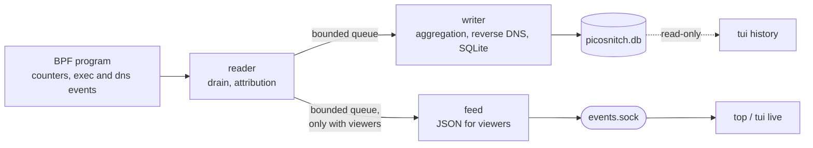

# Design

This document describes how picosnitch collects, attributes and stores traffic, what it can
and cannot see, and the principles the code must keep.

## Goal

Record traffic per process detailed enough to explain a spike after the fact: which program
(path, command line, parent, user, network namespace) exchanged how many bytes with which
remote address, domain and port, in which time window. Security is out of scope: there is no
tamper evidence, no alerting, and a program is identified by its path.

## Data sources

All of them live in one BPF CO-RE program, `src/picosnitch/bpf/picosnitch.bpf.c`, loaded
through the ctypes libbpf wrapper in `bpf_wrapper.py`.

- **Socket byte counters.** fexit programs on `inet_sendmsg`, `inet_recvmsg`,
  `inet6_sendmsg`, `inet6_recvmsg` and `sock_common_recvmsg`, plus `tcp_splice_read` /
  `mptcp_splice_read` (splice and sendfile receives), `tcp_read_sock` restricted to io_uring
  zero-copy receives, and raw `packet_sendmsg` / `packet_recvmsg`, `tun_get_user` /
  `tun_do_read` and AF_XDP copy-mode sends. Opt-in (`mmap_ring_rx`): AF_PACKET and AF_XDP
  mmap-ring receives. Hooks whose kernel symbol is missing are skipped with a log line.
- **In-kernel aggregation.** Bytes and packets are summed per connection, keyed by
  (pid, netns, saddr, daddr, lport, dport, protocol), in LRU hash maps (`conn_stats4`,
  `conn_stats6`, `conn_stats_packet`). Each value also carries the process's and parent's
  comm, device and inode, and the uid. Userspace drains the maps once per second with
  lookup-and-delete, so its cost scales with active connections, not packets.
- **Exec events.** A kretprobe on `execve` sends each new process to a ring buffer. They are
  resolved while the process is young, which fills the caches its connections fall back on
  after it exits, and with `every_exe` they are logged as rows without traffic.
- **Domains.** A uprobe on libc `getaddrinfo` reports each answer, mapping the address to
  the name the program looked up. Addresses without such an answer get a reverse DNS
  lookup (PTR), at most 256 new ones per database write.
- **Startup seed.** Connections open before the daemon started are read from `/proc/net`
  and matched to processes by socket inode, so they appear with zero bytes until traffic
  flows.

Ring buffer drops and near-full aggregation maps are detected and logged, not silent.

## What is and isn't counted

- **Socket bytes, not wire bytes.** Counters see what applications send and receive.
  IP/TCP headers and retransmits are not included: a few percent for bulk transfers, up to
  roughly 44 % for tiny packets.
- **TUN devices.** Reads and writes on a TUN device (WireGuard in userspace such as
  tailscaled, OpenConnect) are counted per process and namespace, without addresses, and
  stored with `family = AF_PACKET` (17).
- **Layers.** On a VPN host the same download can appear up to three times: the program's
  socket inside the tunnel (inner), the VPN client's TUN read (tunnel), and the VPN client's
  encrypted socket (outer). Each row is correct for its layer; totals must not add layers.
- **Forwarded traffic is not seen.** Packets the kernel routes through the host (an exit
  node, NAT) never touch a local socket. Only the VPN client's TUN bytes show up, without
  destinations.
- **Network namespaces.** Every row carries the namespace inode, so processes in separate
  namespaces stay apart.

## Threads

The daemon (`picosnitch run`) is one process with three worker threads, supervised by the
main thread (`main_loop.py`):

- **reader** attaches the BPF program, polls the ring buffers, drains the maps every
  second and attributes each entry to an executable (`monitor.py`).
- **writer** collects the batches, aggregates them per write window, filters them per
  `[log]`, adds domains and writes SQLite (`writer.py`).
- **feed** serializes batches for the live feed, and only receives them while a viewer is
  connected (`main_loop.py`, `live_feed.py`).
- The **main thread** purges past the retention window at startup, sends `READY=1` once
  the probes are attached, exits non-zero when a thread dies so systemd restarts the unit,
  and has the reader re-attach after a suspend (detected as a gap between `CLOCK_BOOTTIME`
  and `CLOCK_MONOTONIC`). On shutdown the reader drains the maps once more and the writer
  writes everything it was handed.

The reader hands each batch over without copying. Its queues drop the oldest batch when
they are full and the drop is logged, so a stalled writer or viewer never stalls the
reader. The writer therefore must not modify the events it receives: the feed may be
serializing the same objects.

One process is enough because what remains besides the reader's attribution is I/O
(SQLite, DNS, sockets), which releases the GIL. Upstream split the work into processes
because hashing executables is CPU-bound and would have starved the reader.

## Executable identity

A process is identified by the path of its executable plus its comm and command line, and
the same for its parent. The reader reads `/proc/<pid>/exe` and accepts the path only if
its device and inode match what BPF recorded at event time; a process that has exec'd
since gets no stale attribution. When the process is already gone, the resolver
(`ExeResolver`) falls back to caches keyed by (device, inode, comm), to a binary found on
disk by comm and verified by inode, and to the last path seen for that inode. A hardlinked
multi-call binary (uutils coreutils) without a live `/proc` entry gets a
`<multi-call:dev=…,ino=…>` label instead of a guessed name.

No binary is opened and no file descriptor is kept. On btrfs, where inodes repeat across
subvolumes, the device check is masked off (`st_dev_mask`).

## Storage

SQLite at `$STATE_DIRECTORY/picosnitch.db`, in WAL mode. Executables, domains and addresses
are interned into lookup tables so connection rows stay small; see [schema.md](schema.md).
Rows are written every `write_limit_seconds`, one row per distinct connection and window.
The schema version sits in `PRAGMA user_version`; there are no migrations.

## Viewers

- `events.sock` in the runtime directory streams every batch as JSON lines to up to 32
  subscribers (`live_feed.py`). Its mode is 0660 and its group is `[viewer] group`, so
  viewers need no capabilities. A subscriber more than 8 MiB behind is dropped.
- `picosnitch top` and the live tab of `picosnitch tui` read that socket; the history views
  of `tui` read the database directly.

## Relationship to upstream

`picosnitch.bpf.c` and `bpf_wrapper.py` are tracked against upstream: they hold the kernel
side and its ctypes mirror, which change in lockstep. Everything above them, including
`monitor.py`, is owned by this fork; its BPF attach and drain code stays structurally close
to upstream so fixes can still be carried over by hand.

## Core principles

1. **The kernel reader never blocks.** Draining and attribution must not wait on disk,
   DNS or a viewer; anything slower happens in another thread behind a bounded queue, and
   data that cannot be kept is dropped and counted, never back-pressured into the BPF maps
   (a full LRU map evicts connections silently).
2. **Identity by path, no file descriptors.** A path is attributed only when its device and
   inode match the event, and caches are keyed by (device, inode); an event without an
   inode is never cached. Holding fds would pin deleted binaries' disk space.
3. **Layers are never summed.** Inner, tunnel and outer rows of the same transfer are each
   right for their layer; any total or rollup keeps them apart.
4. **Socket bytes are labelled as such.** Wherever wire bytes (interface counters,
   conntrack) are added, the two kinds stay separate columns or tables.
5. **The BPF program and `bpf_wrapper.py` stay byte-identical to upstream** unless a change
   is deliberate, and then change together; the struct-size tests in
   `tests/test_robustness.py` guard the mirror.
6. **Bad input never crash-loops the daemon.** A malformed config falls back to defaults
   with a warning, an unknown key is reported, a corrupt database is moved to
   `picosnitch.db.bad` and recreated. Only a database with another schema version stops the
   daemon, so no data is destroyed.
7. **A schema change bumps `DB_VERSION`.** The daemon refuses any other version; there is
   no migration code.
8. **The daemon's capabilities are listed twice and must match:**
   `cli.REQUIRED_CAPABILITIES` and `AmbientCapabilities=` in `systemd/picosnitch.service`.
   Each one carries the reason it is needed.
9. **History stays local.** Nothing is sent off the host apart from reverse DNS lookups.
